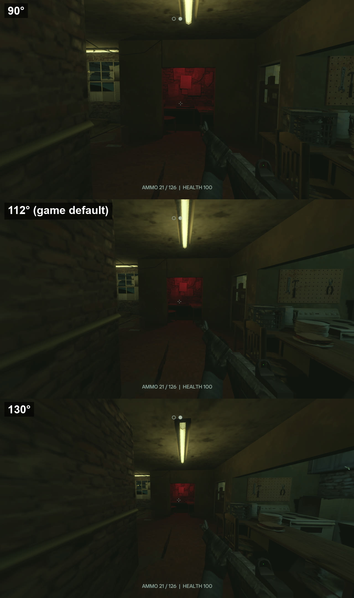
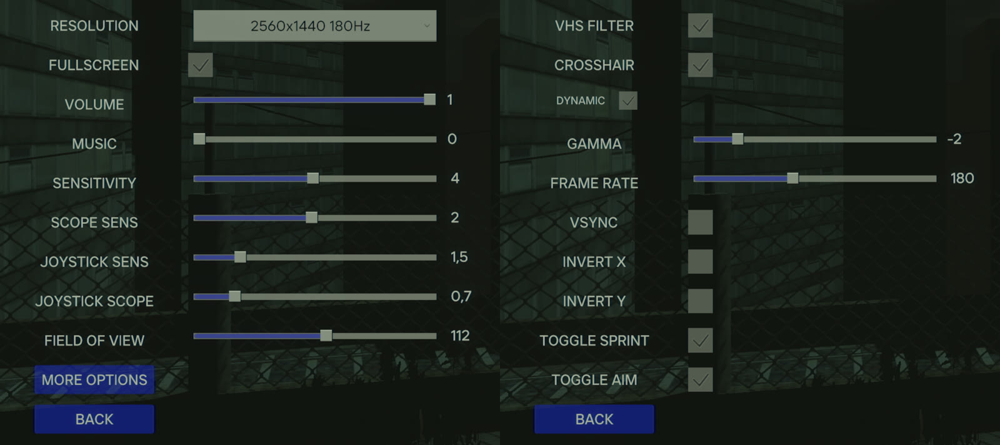

# PatchFace

A quality-of-life mod for PIGFACE. It changes nothing about how the game plays.

## Features

- **Music volume.** A MUSIC slider under VOLUME in Options, separate from the main volume.
- **Field of view.** A FIELD OF VIEW slider in Options, from 90 to 130 degrees across a
  16:9 screen (112 is the game's own view). Aiming and scopes keep their normal zoom
  strength, and guns and hands look the same as without the mod.
- **Toggle sprint.** Press sprint once to run, press again to stop. Sprinting also stops
  when you stop moving forward, crouch, aim, jump, climb a ledge, or ride a zipline.
- **Toggle aim.** Press aim once to aim, press again to stop. With bare hands the button
  works as normal (hold to push).
- **Esc closes the pause menu.** In Options, Esc goes back one screen.
- **Esc on computer screens.** Esc closes the top window, and once none are left, leaves the screen.
- **Ammo and health line.** The ammo counter becomes `AMMO 12 / 36  |  HEALTH 100`.

Toggle sprint and toggle aim can be switched off in Options (second page).
All settings are saved in `BepInEx\config\patchface.pigface.cfg`.

## Screenshots

The same view at three field of view settings. The gun stays the same size, and the
ammo and health line is at the bottom.

The mod's settings in Options: FIELD OF VIEW and MUSIC on the first page, TOGGLE SPRINT
and TOGGLE AIM on the second.

## Install

There are two downloads. Pick one:

- **PatchFace-x.y.z.zip** if you have never modded PIGFACE. It includes BepInEx, the mod loader.
- **PatchFace-x.y.z-mod-only.zip** if you already use BepInEx 5 for other PIGFACE mods.

Both install the same way:

1. In Steam, right-click PIGFACE > Manage > Browse local files.
   This opens the folder that contains `Pigface.exe`.
2. Extract the zip straight into that folder. Don't let Windows put it in a new subfolder.
   - Full zip: `winhttp.dll` and a `BepInEx` folder should now sit next to `Pigface.exe`.
   - Mod-only zip: the mod lands in `BepInEx\plugins\PatchFace`.
3. Start the game as usual. The MUSIC slider in Options shows the mod is running.

Nothing of the game's own files is replaced.

**Steam Deck and Linux:** in Steam, open PIGFACE > Properties > Launch Options and enter:

    WINEDLLOVERRIDES="winhttp=n,b" %command%

## Uninstall

Delete these from the game folder: `winhttp.dll`, `doorstop_config.ini`, `.doorstop_version`,
the `BepInEx` folder, and `PatchFace-README.txt`.

If you use other BepInEx mods, delete only `BepInEx\plugins\PatchFace`.

Steam's "Verify integrity of game files" does not remove the mod.

## Problems

The mod writes what it does to `BepInEx\LogOutput.log`. If a game update breaks one feature,
the log names it and the other features keep working.

## License

PatchFace is released under the MIT license (see `LICENSE`, also included in
`BepInEx\plugins\PatchFace`). It contains no game files.

## Credits

Built on [BepInEx](https://github.com/BepInEx/BepInEx) 5.4.23.6 (MIT license, included in
`BepInEx\licenses`), which bundles Harmony, MonoMod and Mono.Cecil (all MIT).
